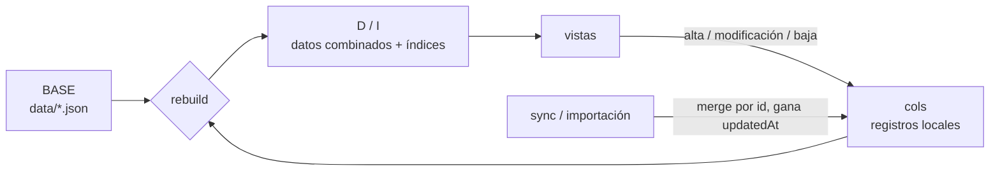
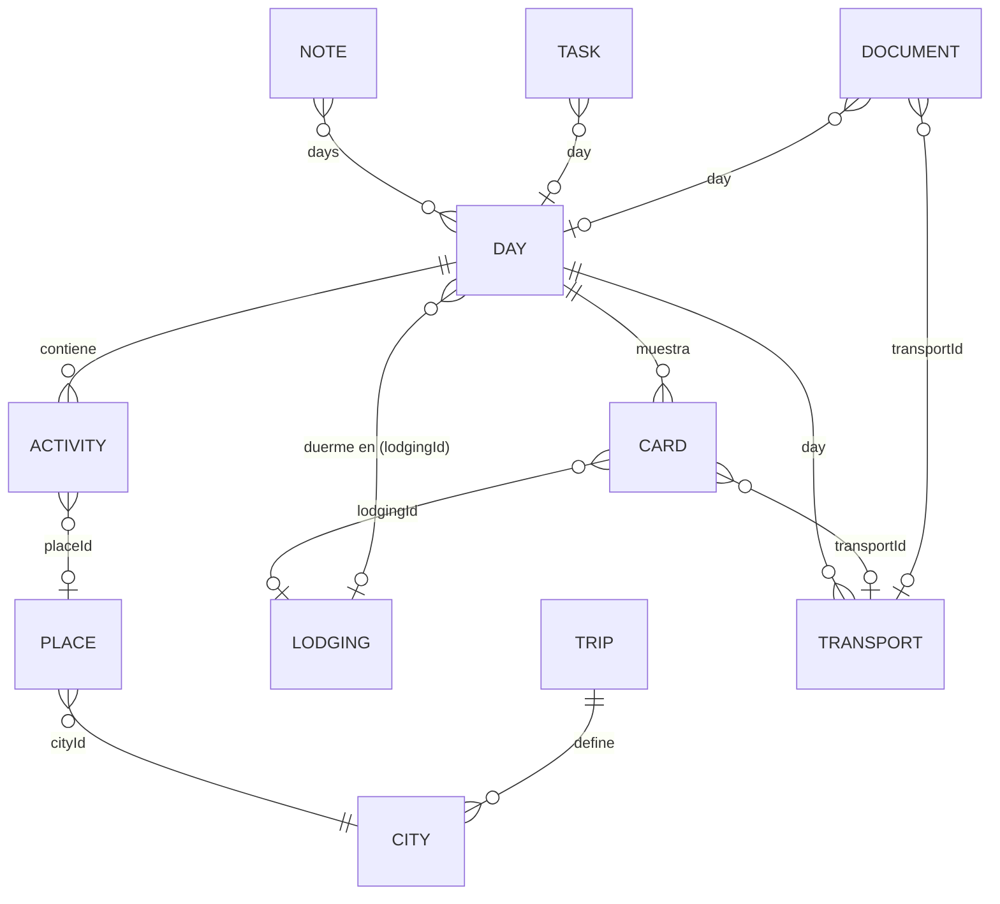
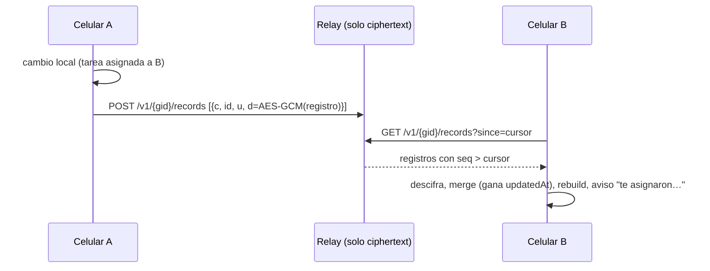
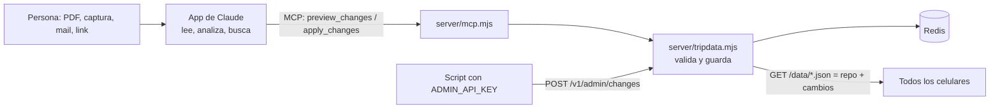

# Arquitectura

Travell es una **PWA**: HTML, CSS y JavaScript (módulos ES) sin framework ni paso de build, más archivos JSON con los datos del viaje, servida por un **backend mínimo** (`server/relay.mjs`) que además sincroniza al grupo con datos cifrados, sube fotos y adjuntos a R2 y baja el clima. Después de la primera visita funciona sin conexión; lo que necesita al backend queda en cola hasta que vuelve la red.

```mermaid
flowchart LR
  subgraph Archivos de la app
    HTML[index.html] --- JS[js/*.js] --- CSS[css/app.css]
    DATA[data/*.json]
    VENDOR[vendor/leaflet]
  end
  subgraph Dispositivo
    SW[Service worker<br/>sw.js]
    CS[(Cache Storage<br/>shell + datos + tiles)]
    LS[(localStorage<br/>ajustes, marcas, gastos, códigos)]
    IDB[(IndexedDB<br/>fotos y adjuntos)]
    APP[App en el navegador]
  end
  TILES[Servidores de tiles<br/>AutoNavi / OSM]
  LINKS[Links externos]
  RELAY[Backend mínimo<br/>server/relay.mjs<br/>sync cifrada, R2, clima]

  APP -- fetch --> SW
  SW -- red primero / caché si no hay --> Archivos de la app
  SW <--> CS
  SW -- caché primero --> TILES
  APP <--> LS
  APP <--> IDB
  APP -. solo con internet .-> LINKS
  APP -. sync cifrada, opcional .-> RELAY
```

## Capas

| Capa | Dónde | Qué guarda | Quién lo escribe |
|---|---|---|---|
| **Datos del viaje** | `data/*.json` (servidor) | Itinerario, transportes, hospedajes, lugares, documentos, viajeros, pendientes, alertas, recursos, frases | Quien arma el viaje (a mano o con un conversor) |
| **Cambios locales (overlay)** | `localStorage`, `travell:<tripId>:col:<colección>` | Altas, modificaciones y bajas de lugares, alojamientos, actividades, tareas y viajeros. Además gastos, ubicaciones y sugerencias descartadas | La app, y la sincronización o la importación |
| **Estado del dispositivo** | `localStorage`, `travell:<tripId>:` | Ajustes (quién soy, relay, mapa), actividades hechas, checklists, códigos cargados | La app |
| **Archivos locales** | IndexedDB `travell-<tripId>` | Fotos (miniatura + original reducido), adjuntos de documentos (PDF, capturas) | La app |
| **Archivos en la nube** | Cloudflare R2, `<tripId>/(photos\|files)/<id>-<128 bits al azar>.<ext>` | Copia de cada foto (original reducido) y de cada adjunto, sin cifrar | `upload.js`, a través del relay |
| **Caché offline** | Cache Storage | App, JSON y tiles de mapa | El service worker |

Los JSON son **de solo lectura** para la app. Lo que el usuario carga (un lugar, un hotel, una tarea, un gasto) se guarda como **registro** en una colección local y se **superpone** al JSON. Así se pueden publicar versiones nuevas del itinerario sin pisar lo cargado en cada celular.

### Overlay: JSON + registros locales



- Cada registro es `{ id, updatedAt, by, deleted?, ...campos }`.
- **Alta**: un id nuevo. **Modificación**: el mismo id que el registro del JSON, con el objeto completo. **Baja**: `{ id, deleted: true }`, que oculta también un registro del JSON.
- `rebuild()` (en `store.js`) combina `BASE` con las colecciones y recalcula todo lo derivado:
  - el hospedaje de cada noche (`day.lodgingId`, eligiendo primero el que esté reservado);
  - noches y días de check-in/out;
  - el orden de las actividades por hora;
  - en qué días aparece cada lugar;
  - los índices.
- Las vistas leen solo `D` e `I`, así que no saben si un dato vino del JSON o de la app. Corre después de cada cambio: con cientos de registros tarda pocos milisegundos.
- **Colecciones editables** (se combinan con el JSON): `places`, `lodging`, `activities`, `tasks`, `travelers`.
- **Colecciones solo locales**: `expenses`, `positions`, `suggestions` (descartadas).
- **Limitación**: un registro del JSON editado en la app queda "congelado" con su versión editada. Si después cambia en el JSON, gana la edición local.

## Estructura del código

```
index.html            Shell: header, <main id="app">, navegación inferior, carga Leaflet y main.js
manifest.webmanifest  Metadatos de instalación (nombre, íconos, colores, start_url)
sw.js                 Service worker (offline)
css/app.css           Estilos sin librería (mobile first, modo oscuro según la hora del celular: de 18:00 a 07:00, con `data-theme` en `<html>` que pone `js/theme.js`). Todo sale de los tokens de :root: 5 tamaños de texto (--fs-*), espaciado (--s1…--s6), radios (--r-*) y 2 alturas de control (--ctl 44px, --ctl-sm 36px)
js/
  main.js             Arranque, router por hash, delegación de eventos, reloj
  store.js            Carga de JSON + índices, localStorage, IndexedDB, reloj simulable, bus de eventos
  tripstate.js        Fase del viaje (antes/durante/después), día actual, actividad actual y siguiente, horarios de salida, zona horaria de cada día y hora
  ics.js              Exportación del viaje a calendario (.ics)
  ui.js               Fragmentos compartidos (badges, filas de actividad, tarjetas de día) y registro de acciones
  sync.js             Sincronización cifrada con el relay, compartir ubicación, link de ubicación
  upload.js           Sube fotos y adjuntos a R2 a través del relay (cola con reintentos)
  ticket.js           Comprobantes (código, QR, link, adjuntos) de pasajes, entradas, hoteles y documentos
  qr.js               Leer QR con la cámara o una imagen y dibujarlos en grande
  weather.js          Clima por día: lo baja del relay una vez por día, copia en localStorage, línea para los heros
  suggest.js          Reglas de "te falta…" (hospedajes, noches sin alojamiento, compras, reservas, preparativos)
  share.js            Exportar e importar los datos cargados en la app, y el respaldo completo (con fotos y adjuntos)
  money.js            Cálculo de gastos puro (división, saldos, transferencias), testeable sin navegador
  map.js              Envoltorio de Leaflet: proveedor de tiles por región, GCJ-02, marcadores, rutas, precarga
  geo.js              WGS-84 → GCJ-02, GPS compartido, links a apps de mapas
  nearby.js           Selección de "puntos de interés cercanos"
  util.js             Fechas y zonas horarias, formato, escape HTML, toasts, modales
  views/              Una pantalla por archivo: home, day, mapview, photos, expenses, docs, more,
                      tasks (tareas y sugerencias), people (viajeros, ubicación, sync), places (ABM de lugares),
                      forms (formularios de ABM y selector de ubicación), search (buscador global)
server/relay.mjs      Backend mínimo (Node, sin dependencias): relay de sincronización; con SERVE_STATIC también sirve la app y GET /v1/weather
server/r2.mjs         Cliente mínimo de Cloudflare R2 (API S3, firma SigV4) para subir, leer y borrar archivos
server/weather.mjs    Clima diario desde Open-Meteo (pronóstico o clima típico), guardado en Redis o en un archivo
server/redis.mjs      Cliente Redis mínimo (RESP, sin dependencias)
server/tripdata.mjs   Cambios de administración sobre data/*.json: validación, merge, guardado en Redis (o archivo)
server/mcp.mjs        Servidor MCP (POST /mcp) para Claude, la única IA que toca el viaje: leer, previsualizar y aplicar cambios
js/admin.js           Recarga del viaje cuando cambia en el servidor (GET /v1/trip/rev)
tests/                Tests con node:test (npm test)
Dockerfile            Imagen para Dokploy u otra plataforma: app + relay en el puerto 3000
vendor/leaflet/       Leaflet 1.9.4 vendorizado (sin CDN, para que funcione offline y en China)
data/                 El viaje (ver "Modelo de datos")
```

### Router y vistas

- Navegación por **hash** (`#/inicio`, `#/dia/d03`, `#/mapa?focus=p-bund`, `#/docs/pasaje`, `#/gastos?day=d04`, …). Funciona en hosting estático sin reescritura de URLs.
- Cada vista exporta `render(params, ctx)` y devuelve HTML como string. `ctx.after(fn)` corre después de insertar el HTML (por ejemplo, para crear un mapa) y `ctx.cleanup(fn)` antes de salir de la vista (para destruir mapas y liberar object URLs).
- `app.rerender()` vuelve a dibujar la vista actual manteniendo el scroll.

### Eventos

Hay un único listener por tipo de evento en `document`:

- `click` en `[data-act="nombre"]` → `actions[nombre](el, event, app)`
- `change` en `[data-change="nombre"]`
- `submit` en `form[data-submit="nombre"]`

Cada vista registra sus acciones con `register({...})`. No se agregan ni quitan listeners al cambiar de pantalla.

### Reloj y fase del viaje

`now()` devuelve la hora real o una **hora simulada** (Ajustes → "Probar con otra fecha"), que se guarda como un desfasaje. `tripPhase()` compara la fecha local con los días del itinerario:

- **pre**: antes del primer día → cuenta regresiva.
- **during**: hay un día con esa fecha → contenido del día; si el día tiene una tarjeta `departure` con `tripStart`, aparece "Hoy es el día del viaje".
- **post**: después del último día.

Cada 15 segundos se actualizan las cuentas regresivas (`[data-countdown]`). Si cambió la fecha, la pantalla de inicio se vuelve a dibujar.

## Modelo de datos

Todo se relaciona con un **día** mediante su id (`"d03"`).



| Archivo | Obligatorio | Contenido principal |
|---|---|---|
| `trip.json` | sí | `id`, título, fechas, `locale`, `cities[]` (centro, zoom, `tiles`), `tileProviders`, `categories`, `poiCategories`, `currencies` (base, lista, cotizaciones), `prefetch` |
| `itinerary.json` | sí | `days[]`: `id`, `n`, `date`, `cityId`, `title`, `summary`, `lodgingId`, `cards[]`, `activities[]` |
| `transport.json` | no | Tramos con `day`, tipo, servicio, horarios, `departAt`/`arriveAt` (ISO), dónde y cuándo comprar |
| `lodging.json` | no | Hospedajes con check-in/out (día y hora), coordenadas, estado, `addressLocal` |
| `places.json` (+ `placeFiles`) | no | Lugares iniciales con `category`, `lat`/`lon`, `nameLocal`, `approx`. `trip.json → placeFiles` lista más archivos (por ejemplo `places-extra.json`): los posteriores extienden o reemplazan por `id` |
| `documents.json` | no | Pasajes, visas, entradas, hoteles: `type`, `code`, `codeLabel`, `file`, `url`, `pin` |
| `travelers.json` | no | Personas que dividen gastos |
| `tasks.json` | no | Tareas con `dueAt` (ISO), `urgent`, `day`, `assignee`, `priority`, `status` y `covers` (qué sugerencias ya cubren, por ejemplo `lodging:l04`) |
| `requirements.json` | no | Preparativos sugeridos: `title`, `detail`, `category`, `countries` (vacío = siempre), `dueDaysBefore`, `covers`, `link` |
| `notes.json` | no | Notas por día (`days[]`; sin días = general): `kind` `tip` \| `recordatorio` \| `alerta`, `title`, `detail`, `time` opcional, `icon` y `links` opcionales. Editables en la app (overlay sincronizado) |
| `phrases.json` | no | Cheat sheet por idioma: `languages` (con `scriptName`), `groups[].phrases[]` y `kanji[].items[]`, cada entrada con `[escritura, romanización, nota?]` por idioma |

**Tarjetas de día** (`cards[]`), genéricas y configurables desde el JSON:

- `departure`: vuelo (`transportId`), anticipación en el aeropuerto (`airportLeadMinutes`), hora de salida (`leaveHomeAt`), checklist y accesos a documentos. Con `tripStart: true` se convierte en el encabezado "Hoy es el día del viaje".
- `arrival`: introducción, opciones de transporte, hospedaje, mapa con `points` y `routes` (polilíneas), links de interés.
- `info`: texto y links libres.

Varios viajes: `?data=trips/otro` carga otra carpeta. El estado local se separa por `trip.id`.

## Mapas

- **Leaflet 1.9.4**, vendorizado en el repo. No usa ningún servicio de Google, que está bloqueado en China.
- **Proveedor de tiles por región.** Cada ciudad de `trip.json` declara su proveedor (`gaode` o `osm`). En modo automático, el mapa elige el proveedor de la ciudad más cercana al centro de la vista y cambia al moverse. El usuario puede fijar uno en Ajustes o con el botón del mapa.
- **GCJ-02.** Los tiles chinos usan un sistema de coordenadas desplazado. Los datos se guardan en WGS-84 (GPS estándar) y `TripMap.proj()` los convierte solo cuando el proveedor tiene `gcj02: true`. El GPS del usuario también se convierte.
- **Contenido** como lista de ítems lógicos (`poi`, `lodging`, `point`, `route`). Al cambiar de proveedor se vuelven a dibujar con la proyección correcta.
- **Cerca de vos** (`nearby.js`): si el GPS está a menos de 60 km de algún lugar del viaje, ordena por distancia (radio de 4 km, que se amplía a 15 km si hay pocos resultados). Si no, muestra la ciudad del día.
- Links a apps de mapas: Amap (`uri.amap.com`, acepta WGS-84) en China, OpenStreetMap o Google fuera de China.

## Modo offline

### Service worker (`sw.js`)

| Recurso | Estrategia | Caché |
|---|---|---|
| Shell (HTML, JS, CSS, Leaflet, íconos) y `data/*.json` | Precarga en `install`. Después, **red primero con timeout** (3,5 s si hay copia en caché, si no 15 s) y se guarda la respuesta | `travell-shell-v1` |
| Tiles de mapa (URLs `{z}/{x}/{y}.png` o `appmaptile`) | **Caché primero**. Si no hay copia, va a la red y la guarda (respuestas opacas incluidas). Máximo 2500 tiles | `travell-tiles-v1` |
| Otros orígenes (links externos) | Sin intervención | — |
| Navegación sin red | Devuelve `index.html` desde caché | — |

- Red primero (con timeout) hace que una actualización de los JSON llegue apenas hay conexión, y que con mala señal no se quede esperando.
- Al cambiar `VERSION` se crea una caché nueva y la vieja se borra en `activate`. La de tiles se conserva.
- **Guardar zona offline**: calcula los tiles que cubren los puntos visibles (zooms 12–15, hasta `prefetch.maxTiles` por proveedor) y los guarda en la misma caché que usa el service worker.
- El service worker se registra solo en HTTPS o `localhost`. Abriendo `index.html` con doble clic (`file://`) no funciona ni la carga de JSON.

### Qué funciona sin conexión

| Funciona offline | Necesita internet |
|---|---|
| Todo el itinerario, días, tarjetas, alertas, pendientes | Links externos (metro, webs oficiales) |
| Documentos, códigos y adjuntos | Abrir un lugar en Amap, OSM o Google |
| Fotos (agregar, ver, mover de día) | Tiles de zonas nunca vistas ni precargadas |
| Gastos, tareas, sugerencias y ABM (lugares, hoteles, actividades) | Sincronizar con el relay (los cambios esperan y se envían al volver la conexión) |
| GPS, "cerca de vos" y elegir ubicación con el GPS | Primera carga de la app |
| Última ubicación conocida de los demás | Ubicación en vivo de los demás |
| Mapas de zonas ya vistas o precargadas | |

### Persistencia

Al agregar fotos o adjuntos se pide `navigator.storage.persist()` para que el navegador no borre los datos por falta de espacio. Ajustes muestra el espacio usado y si el almacenamiento es persistente.

## Sincronización y ubicación del grupo

La app funciona completa en un solo celular. Para compartir entre viajeros hay tres niveles, de menor a mayor infraestructura:

| Mecanismo | Qué comparte | Necesita |
|---|---|---|
| **Link de ubicación** (`#/ubicacion?t=&lat=&lon=&ts=`) | La ubicación en ese momento | Nada: se manda por WhatsApp y se abre con la app |
| **Exportar e importar archivo** | Todas las colecciones del overlay | Nada: se manda el archivo |
| **Relay** (`server/relay.mjs`) | Todas las colecciones, automático | Un servidor Node con HTTPS |

### Relay



- **Clave**: PBKDF2-SHA256 (150 000 iteraciones), aplicado al código del grupo con la sal `travell:<tripId>`, que da una clave AES-GCM de 256 bits.
- **Id del grupo**: `gid` = SHA-256(`travell-group:<tripId>:<código>`), primeros 16 bytes. El relay nunca recibe el código.
- El relay guarda, por grupo, el último registro de cada `(colección, id)` con un número de secuencia, y lo persiste en `RELAY_DATA/<gid>.json`. Ve los nombres de colección, los ids y las fechas, pero no el contenido.
- **Cliente** (`sync.js`): sube lo que cambió desde el último envío y baja desde un cursor por grupo. Sincroniza cada 60 s con la app visible, a los 2,5 s de un cambio local, al volver a la app y al recuperar la conexión. Si el relay se reinicia y pierde la secuencia, el cliente vuelve a bajar todo.
- **Conflictos**: gana la última escritura por registro (`updatedAt`). Alcanza para un grupo chico de viaje.
- **Ubicación**: con "Compartir mi ubicación" activo, cada fix del GPS escribe `positions/<yo>` si pasaron 2 minutos o hubo más de 50 m de movimiento. Dejar de compartir borra el registro. Solo funciona con la app abierta: una web no puede seguir la ubicación en segundo plano.
- **Avisos**: al recibir una tarea asignada a mí y creada por otro viajero, muestra un toast y, si hay permiso, una notificación del sistema.
- **Deploy**: el `Dockerfile` corre `server/relay.mjs` con `SERVE_STATIC=/app`, así un solo contenedor sirve la PWA (con una lista blanca de rutas públicas) y el relay. Con `trip.json → sync.relayUrl: "same-origin"`, la app usa su propio origen como relay. Los datos del relay van al volumen `/data`.
### Comprobantes (`ticket.js`, `qr.js`)

- Un **comprobante** cuelga de algo ya modelado, con la clave `<tipo>:<id>`: `transport:t01` (pasaje), `activity:A052` (entrada), `lodging:l03` (hotel), `doc:doc04` (documento no modelado) o `passport:<viajero>`.
- El código de reserva vive en el propio registro (`transport.code`, `documents.code`, `lodging.confirmation`). Los QR (`qrs: [{ id, text, format, label }]`), el link y un código escrito en la app van en la colección `tickets` (clave `<tipo>:<id>`): base en `data/tickets.json` más lo que se edita en la app (overlay sincronizado); un código ahí tapa al del registro. Igual con `expenses` y `passports`. Los adjuntos van en IndexedDB `files` con `docId` = la clave, y se suben a R2.
- `qr.js` lee códigos con `BarcodeDetector` si el navegador lo tiene, y si no con jsQR (`vendor/jsqr`); dibuja los QR con qrcode-generator (`vendor/qrcode`). Las dos se cargan solo al usarlas y quedan en el caché offline.
- `documents.json` solo tiene lo no modelado. `migrateDocuments()` mueve una vez los códigos (`docCodes`) y adjuntos de los documentos viejos a su comprobante, hotel o pasaporte.
- Alojamientos: `bookingUrl` es el link a la reserva (Booking, Trip.com…); `link` sigue siendo el sitio del hotel.
- **Vista del día** (`js/views/day.js`): tarjetas del día (salida, llegada), una tarjeta por vuelo (horarios, aeropuertos, duración, código y QR), notas, actividades, la tarjeta "Dónde dormís" (siempre, no solo el día del check-in: noche N de M, check-out del hotel anterior, reserva, dirección para el taxista; en los días sin traslados, con un mapa centrado en el hospedaje) y "Logística" solo para los traslados que no son vuelos. En la tarjeta de salida, si salir del hotel y estar en el aeropuerto caen a la misma hora, se muestra solo la salida.
- **Mate** (`js/mate.js`, sonidos en `js/mate-sound.js`, vista `js/views/mate.js`, ruta `#/mate`): un time killer a la Tapper que viene de otro proyecto, para vuelos, trenes y esperas. Ocupa toda la pantalla; en el celular se juega con una cruz (↑ ↓ barra, ← → caminar) y el botón Cebar (mantener y soltar), en vertical o en horizontal (cruz a la izquierda, Cebar a la derecha); en la computadora, con el teclado. Muestra cuánto falta para aterrizar o para que salga el vuelo o el tren. Se sugiere en el día y en Inicio cuando hay un vuelo o un tren. El récord y el silencio quedan en el celular (`localStorage`). La partida sigue aunque la pantalla se redibuje (sincronización, clima): solo se corta al salir de `#/mate`.
- **Entrenar** (vista `js/views/train.js`, ruta `#/entrenar`; ejercicios `js/camino.js`, `js/clasificar.js`, `js/eco.js`): ejercicios cortos de entrenamiento mental, al estilo de Peak, para quien no quiere jugar al Mate. A diferencia del Juego del día no hay ranking entre viajeros ni "tu nivel": cada celular guarda el historial de sus sesiones (aciertos de cada una, la mejor marcada; una sesión cortada con "Terminar" queda anotada pero no cuenta como mejor), en `localStorage` `travell-train-history`. **Camino** (como Perilous Path): se ven los pozos unos segundos y hay que cruzar sin pisarlos; son 6 cruces. **Clasificar** (como Must Sort): cada figura va a la izquierda o a la derecha según una regla (color, forma, cantidad) que cambia sin avisar; dura 1 minuto. **Eco** (como Rush Back, n-back): ¿el símbolo es igual al anterior, o al de 2 o 3 antes?; dura 1 minuto. La dificultad se ajusta sola y en silencio, y la próxima sesión arranca donde quedó; se guarda en el celular (`localStorage` `travell-train`). El reloj se frena con la pantalla apagada. En horizontal, las respuestas van a los costados de la figura. Para sumar un ejercicio: un módulo con `mount(el, { level, report, onFinish }) → { level(), destroy() }` y una entrada en `EXERCISES`. La tarjeta del Mate en días de vuelo o tren ofrece también Entrenar.
- **Lo que es solo de algunos viajeros** lleva `travelers: [ids]` (sin el campo es de todos): un vuelo o una habitación de uno, una actividad aparte, una tarjeta del día (`days[].cards`). Si el grupo se separa se carga un registro por parte (ej. `t04` para Pehuén y Sole, `t-ca919` para Facundo, con una tarjeta de salida y una de llegada para cada uno). Cada celular (`me()`, `forMe()` en `js/store.js`) muestra sus tarjetas, toma su alojamiento para la noche y su vuelo para el cambio de huso, saltea lo ajeno en "Ahora / sigue" y en el calendario, y ve lo de los demás atenuado con la etiqueta "Solo Facundo". Un celular sin nombre ve todo. Las actividades y los alojamientos tienen el campo "Quiénes" en su formulario.

### Fotos y adjuntos en R2

- Toda foto o adjunto se sube **siempre** a Cloudflare R2, haya grupo configurado o no. La copia local en IndexedDB sigue siendo la que muestra la app, así que todo anda sin conexión.
- **Cliente** (`upload.js`): sube lo que no tenga `remote` con `PUT /v1/files/<clave>` y al terminar guarda `remote: { key, at }` en el registro. Reintenta al abrir la app, al volver a primer plano, al recuperar la conexión, a los 60 s de un error y después de agregar archivos. Borrar una foto o adjunto borra también la copia en R2 (si no hay conexión, queda en cola en `r2:deletes`). Ajustes muestra cuántos hay subidos.
- **Relay** (`server/r2.mjs`): firma los pedidos con AWS SigV4 y reenvía a R2; `GET` devuelve el archivo en streaming. Las credenciales solo están en el servidor. Acepta imágenes, PDF y binarios de hasta 30 MB.
- **Acceso**: los archivos **no van cifrados** (decisión explícita). No hay autenticación: el nombre lleva 128 bits al azar y funciona como capacidad (quien lo conoce puede leer o borrar ese archivo). Cualquiera que llegue al relay puede subir archivos.

### Redis

Guarda el clima (`<REDIS_KEY_PREFIX>weather:<tripId>`) y los cambios de administración al viaje (`<REDIS_KEY_PREFIX>trip:<tripId>:changes`, ver abajo).

### Cambios de administración y MCP

Tres capas de datos, de abajo hacia arriba:

1. **El repo** (`data/*.json`): la base. Se edita acá, con commits.
2. **Cambios de administración** (servidor, en Redis): lo que se cambia desde afuera de la app con `ADMIN_API_KEY`: la API de administración y el MCP (Claude). El servidor los aplica al servir `/data/<archivo>.json`, así la app los lee como si fueran el archivo. Si Redis falla, sirve el archivo del repo tal cual.
3. **Overlay del grupo** (cifrado, en el relay): lo que cada viajero edita en la app (tareas, gastos, códigos…). Va encima de todo. Lo que carga Claude va en la capa 2, en claro en el servidor (decisión explícita, para que el MCP pueda hacer todo lo que hace la app).



- **Una sola validación**: todo cambio al viaje pasa por `trip.apply()`, desde `/v1/admin/changes` o desde el MCP (con `ADMIN_API_KEY`). Un cambio es `{ op: put | patch | del, col, id, data, label }`; el lote se valida entero (colección conocida, ids, fechas, horas, que exista el día de una actividad, check-out después del check-in…) y se aplica todo o nada. Colecciones: `trip`, `days` (campos del día, no sus actividades), `activities` (con `dayId`), `places`, `transport`, `lodging`, `documents`, `travelers`, `tasks`, `notes`, `requirements`, `resources`, `tickets` (id `<tipo>:<id>` de algo que existe), `expenses` (montos, viajeros y división válidos) y `passports` (id = viajero).
- **La app no tiene IA ni funciones de administración**: la clave es una variable de entorno del servidor y nunca llega al navegador.
- **Recarga**: cada cambio sube una revisión (`GET /v1/trip/rev`). La app la consulta cada 2 minutos y al volver a primer plano, y si cambió recarga los datos.
- **Historial**: se guardan los últimos 200 lotes (quién, cuándo, nota, frases). `GET /v1/admin/changes` lista lo que difiere del repo, para pasarlo al repo cuando convenga; `DELETE /v1/admin/changes/<col>/<id>` vuelve un registro a lo que dice el repo.
- **Claude por MCP** (`server/mcp.mjs`): en vez de un agente propio, la app de Claude (o Claude Code) se conecta a `POST /mcp` (MCP *Streamable HTTP*, sin estado, respuestas JSON) con `Authorization: Bearer $ADMIN_API_KEY`, o a `POST /mcp/<ADMIN_API_KEY>` cuando el cliente no puede mandar headers (conector personalizado de la app de Claude). La clave del path no se escribe en los logs. Claude lee la reserva con sus propias herramientas (PDF, imagen, búsqueda) antes de usar el MCP. Herramientas: `trip_overview` (lo de `tripContext()`), `get_day`, `get_records`, `preview_changes` (valida y muestra antes → después, sin guardar), `apply_changes` (= `trip.apply()`, misma validación y mismo Redis que `/v1/admin/changes`; queda en el historial como `claude (mcp)`), `list_changes` y `revert_record`. Las reglas del formato van en las `instructions` del servidor. Para "cambiá el día 5 por esto": Claude lee el día, arma el lote, lo previsualiza, la persona confirma y se aplica.

- **Requisitos**: el relay tiene que estar en HTTPS si la app está en HTTPS (contenido mixto), y conviene alojarlo donde sea accesible desde China. Ejecución: `PORT=8787 RELAY_DATA=./relay-data node server/relay.mjs`.

### Sugerencias

`suggest.js` aplica reglas sobre `D`:

- noches sin hospedaje;
- hospedajes por reservar;
- tareas hechas cuyo hospedaje sigue pendiente;
- transportes sin comprar;
- actividades con reserva necesaria;
- documentos pendientes y vuelos reservados sin código;
- preparativos de `requirements.json` filtrados por los países de `trip.cities`.

Cada sugerencia tiene una clave estable (`lodging:l04`, `gap:2026-11-25`, `req:fiebre-amarilla`). Se oculta si una tarea la cubre (`covers` o `source: "sug:<clave>"`) o si se marcó "ya está" o "no aplica" (colección `suggestions`, que también se sincroniza).

## Tests

`npm test` corre los tests con `node --test`, sin dependencias. Los módulos de la app son ES modules sin build, así que se importan directamente. `tests/helpers.mjs` simula `localStorage`, `location` y un `fetch` que lee de `data/`.

| Archivo | Cubre |
|---|---|
| `money.test.mjs` | División igual o a medida, conversión de monedas, saldos y transferencias mínimas |
| `geo.test.mjs` | Desfasaje GCJ-02 e ida y vuelta con error menor a 1 m |
| `data.test.mjs` | Carga de JSON + `placeFiles`, overlay (alta, baja, modificación, restaurar), hospedaje por noche, orden de actividades, sugerencias, "gana la última escritura", fase del viaje |
| `sw.test.mjs` | La lista de precarga offline (`CORE`) está completa y apunta a archivos reales |
| `relay.test.mjs` | Relay real en un puerto al azar: cursor, "gana la última escritura", validaciones, lista blanca de archivos estáticos |

Las pruebas de interfaz (dos celulares, sincronización, offline) se corrieron con Playwright y Chromium, pero todavía no forman parte del repo.

## Deploy en el lab

- La app está creada en Dokploy como **travell** (https://travell.unab.dpdns.org). Construye el `Dockerfile` del repo `unab-lab/travell` en cada push a `main`, en el puerto 3000.
- El volumen `/data` guarda los datos cifrados del relay.

## Decisiones y alternativas

| Decisión | Motivo | Costo |
|---|---|---|
| Sin framework ni build | Cero dependencias que mantener, se edita y publica directo | Plantillas con strings; hay que cuidar el escape (`esc()`) |
| JSON en lugar de base de datos | Legible, versionable en git, generable desde Excel | Editar el viaje requiere tocar archivos |
| localStorage para estado chico | Simple y síncrono | Límite de ~5 MB, que alcanza para gastos, tareas, lugares y marcas |
| Overlay sobre JSON en vez de editar los archivos | El backend no guarda el viaje, y las actualizaciones del JSON no pisan lo cargado | Una edición local "congela" ese registro |
| Backend mínimo propio, con relay cifrado de punta a punta | Sin cuentas ni terceros que lean los datos; un archivo, sin dependencias | Hay que alojarlo; gana la última escritura, sin edición colaborativa fina |
| IndexedDB para blobs | Fotos y PDFs sin límite práctico | API más verbosa (envoltorio en `store.js`) |
| Tiles raster públicos | Simple, sin claves | Precarga limitada por los términos de uso; no hay mapas vectoriales offline completos |
| Fotos reducidas a 1800 px | Ahorra espacio | No es un respaldo de los originales |

## Seguridad y privacidad

- Todo el texto de los JSON y del usuario pasa por `esc()` antes de insertarse como HTML.
- No hay analytics, cookies ni llamadas a terceros salvo tiles, links que el usuario abre y el relay que él mismo configure.
- Fotos y adjuntos (incluidos escaneos de pasaportes) se suben sin cifrar a R2: quien tenga acceso al bucket los puede ver.
- La ubicación se comparte solo si el usuario lo activa, y viaja cifrada.
- El código del grupo es la única protección: tiene que ser largo y no publicarse. Cambiarlo crea otro grupo.
- El relay valida tamaños (2 MB por pedido, 256 KB por registro, 50 000 registros por grupo) pero no tiene autenticación: cualquiera que adivine un `gid` podría llenar ese grupo con basura, aunque no leerlo.
- Los códigos y los datos del pasaporte quedan en el dispositivo (los adjuntos no: ver arriba). Conviene no subirlos al JSON público si el sitio está publicado.

Ver también: [VISION.md](VISION.md) · [FEATURES.md](FEATURES.md) · [BACKLOG.md](BACKLOG.md)
