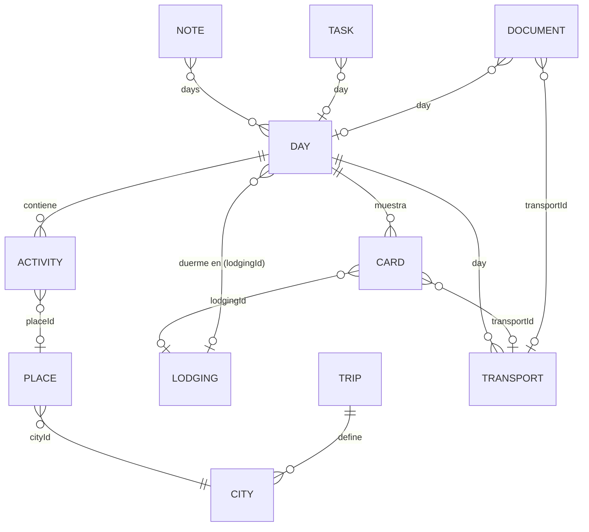

# Arquitectura

Travell es una **PWA estática**: HTML, CSS y JavaScript (módulos ES) sin framework ni paso de build, más archivos JSON con los datos del viaje. Se publica en cualquier hosting estático y, después de la primera visita, funciona sin conexión.

```mermaid
flowchart LR
  subgraph Hosting estático
    HTML[index.html] --- JS[js/*.js] --- CSS[css/app.css]
    DATA[data/*.json]
    VENDOR[vendor/leaflet]
  end
  subgraph Dispositivo
    SW[Service worker<br/>sw.js]
    CS[(Cache Storage<br/>shell + datos + tiles)]
    LS[(localStorage<br/>ajustes, marcas, gastos, códigos)]
    IDB[(IndexedDB<br/>fotos y adjuntos)]
    APP[App en el navegador]
  end
  TILES[Servidores de tiles<br/>AutoNavi / OSM]
  LINKS[Links externos]

  APP -- fetch --> SW
  SW -- red primero / caché si no hay --> Hosting estático
  SW <--> CS
  SW -- caché primero --> TILES
  APP <--> LS
  APP <--> IDB
  APP -. solo con internet .-> LINKS
```

## Capas

| Capa | Dónde | Qué guarda | Quién lo escribe |
|---|---|---|---|
| **Datos del viaje** | `data/*.json` (servidor) | Itinerario, transportes, hospedajes, lugares, documentos, viajeros, pendientes, alertas, enlaces | Quien arma el viaje (a mano o con un conversor) |
| **Estado local** | `localStorage`, con la clave `travell:<tripId>:` | Ajustes, actividades hechas, pendientes resueltos, checklists, códigos cargados, gastos | La app |
| **Archivos locales** | IndexedDB `travell-<tripId>` | Fotos (miniatura + original reducido), adjuntos de documentos (PDF, capturas) | La app |
| **Caché offline** | Cache Storage | App, JSON y tiles de mapa | El service worker |

Los JSON son **de solo lectura** para la app. Lo que el usuario carga en el dispositivo (un código de reserva, una foto, un gasto) va al estado local y **tapa** el valor del JSON sin modificar el archivo. Así se pueden publicar versiones nuevas del itinerario sin pisar lo cargado en cada celular.

## Estructura del código

```
index.html            Shell: header, <main id="app">, navegación inferior, carga Leaflet y main.js
manifest.webmanifest  Metadatos de instalación (nombre, íconos, colores, start_url)
sw.js                 Service worker (offline)
css/app.css           Estilos (mobile first, modo oscuro con prefers-color-scheme)
js/
  main.js             Arranque, router por hash, delegación de eventos, reloj
  store.js            Carga de JSON + índices, localStorage, IndexedDB, reloj simulable, bus de eventos
  tripstate.js        Fase del viaje (antes/durante/después), día actual, actividad actual y siguiente, horarios de salida
  ui.js               Fragmentos compartidos (badges, filas de actividad, tarjetas de día) y registro de acciones
  map.js              Envoltorio de Leaflet: proveedor de tiles por región, GCJ-02, marcadores, rutas, precarga
  geo.js              WGS-84 → GCJ-02, GPS compartido, links a apps de mapas
  nearby.js           Selección de "puntos de interés cercanos"
  util.js             Fechas, formato, escape HTML, toasts, modales
  views/              Una pantalla por archivo: home, day, mapview, photos, expenses, docs, more
vendor/leaflet/       Leaflet 1.9.4 vendorizado (sin CDN, para que funcione offline y en China)
data/                 El viaje (ver "Modelo de datos")
```

### Router y vistas

- Navegación por **hash** (`#/inicio`, `#/dia/d03`, `#/mapa?focus=p-bund`, `#/docs/pasaje`, `#/gastos?day=d04`, …). Funciona en hosting estático sin reescritura de URLs.
- Cada vista exporta `render(params, ctx)` y devuelve HTML como string. `ctx.after(fn)` corre después de insertar el HTML (por ejemplo, para crear un mapa) y `ctx.cleanup(fn)` antes de salir de la vista (para destruir mapas y liberar object URLs).
- `app.rerender()` vuelve a dibujar la vista actual manteniendo el scroll.

### Eventos

Hay un único listener por tipo de evento en `document`:

- `click` en `[data-act="nombre"]` → `actions[nombre](el, event, app)`
- `change` en `[data-change="nombre"]`
- `submit` en `form[data-submit="nombre"]`

Cada vista registra sus acciones con `register({...})`. No se agregan ni quitan listeners al cambiar de pantalla.

### Reloj y fase del viaje

`now()` devuelve la hora real o una **hora simulada** (Ajustes → "Probar con otra fecha"), que se guarda como un desfasaje. `tripPhase()` compara la fecha local con los días del itinerario:

- **pre**: antes del primer día → cuenta regresiva.
- **during**: hay un día con esa fecha → contenido del día; si el día tiene una tarjeta `departure` con `tripStart`, aparece "Hoy es el día del viaje".
- **post**: después del último día.

Cada 15 segundos se actualizan las cuentas regresivas (`[data-countdown]`). Si cambió la fecha, la pantalla de inicio se vuelve a dibujar.

## Modelo de datos

Todo se relaciona con un **día** mediante su id (`"d03"`).



| Archivo | Obligatorio | Contenido principal |
|---|---|---|
| `trip.json` | sí | `id`, título, fechas, `locale`, `cities[]` (centro, zoom, `tiles`), `tileProviders`, `categories`, `poiCategories`, `currencies` (base, lista, cotizaciones), `prefetch` |
| `itinerary.json` | sí | `days[]`: `id`, `n`, `date`, `cityId`, `title`, `summary`, `lodgingId`, `cards[]`, `activities[]` |
| `transport.json` | no | Tramos con `day`, tipo, servicio, horarios, `departAt`/`arriveAt` (ISO), dónde y cuándo comprar |
| `lodging.json` | no | Hospedajes con check-in/out (día y hora), coordenadas, estado, `addressLocal` |
| `places.json` | no | Lugares con `category`, `lat`/`lon`, `nameLocal`, `approx`, `days[]` |
| `documents.json` | no | Pasajes, visas, entradas, hoteles: `type`, `code`, `codeLabel`, `file`, `url`, `pin` |
| `travelers.json` | no | Personas que dividen gastos |
| `tasks.json` | no | Pendientes con `dueAt` (ISO con zona horaria), `urgent`, `day` |
| `notes.json` | no | Alertas por día (`days[]`) o generales |
| `links.json` | no | Enlaces por ciudad o día, y fuentes |

**Tarjetas de día** (`cards[]`), genéricas y configurables desde el JSON:

- `departure`: vuelo (`transportId`), anticipación en el aeropuerto (`airportLeadMinutes`), hora de salida (`leaveHomeAt`), checklist y accesos a documentos. Con `tripStart: true` se convierte en el encabezado "Hoy es el día del viaje".
- `arrival`: introducción, opciones de transporte, hospedaje, mapa con `points` y `routes` (polilíneas), links de interés.
- `info`: texto y links libres.

Varios viajes: `?data=trips/otro` carga otra carpeta. El estado local se separa por `trip.id`.

## Mapas

- **Leaflet 1.9.4**, vendorizado en el repo. No usa ningún servicio de Google, que está bloqueado en China.
- **Proveedor de tiles por región.** Cada ciudad de `trip.json` declara su proveedor (`gaode` o `osm`). En modo automático, el mapa elige el proveedor de la ciudad más cercana al centro de la vista y cambia al moverse. El usuario puede fijar uno en Ajustes o con el botón del mapa.
- **GCJ-02.** Los tiles chinos usan un sistema de coordenadas desplazado. Los datos se guardan en WGS-84 (GPS estándar) y `TripMap.proj()` los convierte solo cuando el proveedor tiene `gcj02: true`. El GPS del usuario también se convierte.
- **Contenido** como lista de ítems lógicos (`poi`, `lodging`, `point`, `route`). Al cambiar de proveedor se vuelven a dibujar con la proyección correcta.
- **Cerca de vos** (`nearby.js`): si el GPS está a menos de 60 km de algún lugar del viaje, ordena por distancia (radio de 4 km, que se amplía a 15 km si hay pocos resultados). Si no, muestra la ciudad del día.
- Links a apps de mapas: Amap (`uri.amap.com`, acepta WGS-84) en China, OpenStreetMap o Google fuera de China.

## Modo offline

### Service worker (`sw.js`)

| Recurso | Estrategia | Caché |
|---|---|---|
| Shell (HTML, JS, CSS, Leaflet, íconos) y `data/*.json` | Precarga en `install`. Después, **red primero con timeout** (3,5 s si hay copia en caché, si no 15 s) y se guarda la respuesta | `travell-shell-v1` |
| Tiles de mapa (URLs `{z}/{x}/{y}.png` o `appmaptile`) | **Caché primero**. Si no hay copia, va a la red y la guarda (respuestas opacas incluidas). Máximo 2500 tiles | `travell-tiles-v1` |
| Otros orígenes (links externos) | Sin intervención | — |
| Navegación sin red | Devuelve `index.html` desde caché | — |

- Red primero (con timeout) hace que una actualización de los JSON llegue apenas hay conexión, y que con mala señal no se quede esperando.
- Al cambiar `VERSION` se crea una caché nueva y la vieja se borra en `activate`. La de tiles se conserva.
- **Guardar zona offline**: calcula los tiles que cubren los puntos visibles (zooms 12–15, hasta `prefetch.maxTiles` por proveedor) y los guarda en la misma caché que usa el service worker.
- El service worker se registra solo en HTTPS o `localhost`. Abriendo `index.html` con doble clic (`file://`) no funciona ni la carga de JSON.

### Qué funciona sin conexión

| Funciona offline | Necesita internet |
|---|---|
| Todo el itinerario, días, tarjetas, alertas, pendientes | Links externos (metro, webs oficiales) |
| Documentos, códigos y adjuntos | Abrir un lugar en Amap, OSM o Google |
| Fotos (agregar, ver, mover de día) | Tiles de zonas nunca vistas ni precargadas |
| Gastos y saldos | Compartir el archivo de gastos (según el método) |
| GPS y "cerca de vos" (el GPS no usa datos) | Primera carga de la app |
| Mapas de zonas ya vistas o precargadas | |

### Persistencia

Al agregar fotos o adjuntos se pide `navigator.storage.persist()` para que el navegador no borre los datos por falta de espacio. Ajustes muestra el espacio usado y si el almacenamiento es persistente.

## Sincronización entre dispositivos

No hay servidor. Los gastos se comparten con **exportar/importar JSON** (con la hoja de compartir del sistema si está disponible). La importación une por `id`: gana el registro con `updatedAt` más nuevo y los borrados viajan como `deleted: true`, así no reaparecen.

## Decisiones y alternativas

| Decisión | Motivo | Costo |
|---|---|---|
| Sin framework ni build | Cero dependencias que mantener, se edita y publica directo | Plantillas con strings; hay que cuidar el escape (`esc()`) |
| JSON en lugar de base de datos | Legible, versionable en git, generable desde Excel | Editar el viaje requiere tocar archivos |
| localStorage para estado chico | Simple y síncrono | Límite de ~5 MB, que alcanza para gastos y marcas |
| IndexedDB para blobs | Fotos y PDFs sin límite práctico | API más verbosa (envoltorio en `store.js`) |
| Tiles raster públicos | Simple, sin claves | Precarga limitada por los términos de uso; no hay mapas vectoriales offline completos |
| Fotos reducidas a 1800 px | Ahorra espacio | No es un respaldo de los originales |

## Seguridad y privacidad

- Todo el texto de los JSON y del usuario pasa por `esc()` antes de insertarse como HTML.
- No hay analytics, cookies ni llamadas a terceros salvo tiles y links que el usuario abre.
- Los datos sensibles (códigos, pasaporte) quedan en el dispositivo. Conviene no subirlos al JSON público si el sitio está publicado.

Ver también: [VISION.md](VISION.md) · [FEATURES.md](FEATURES.md) · [BACKLOG.md](BACKLOG.md)
